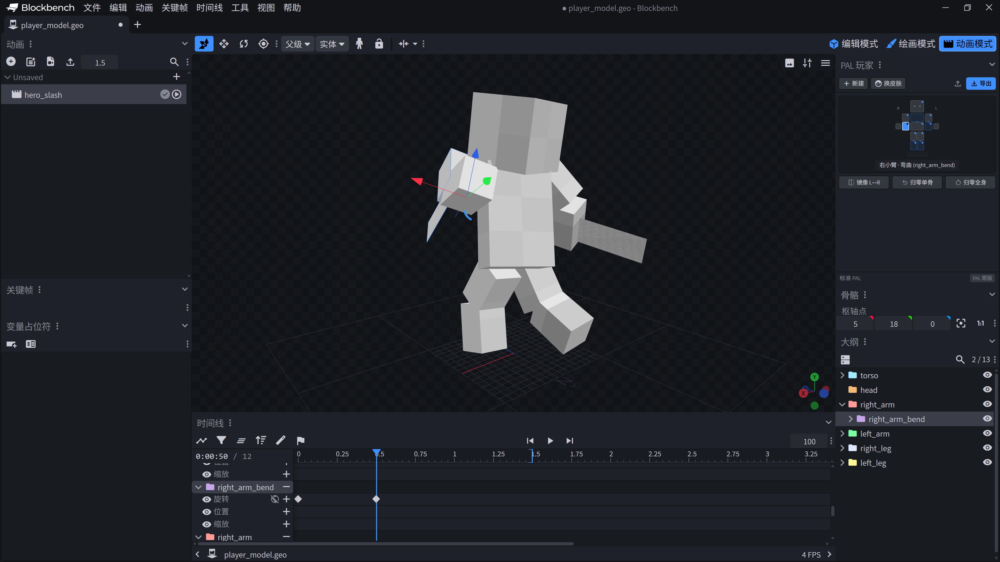
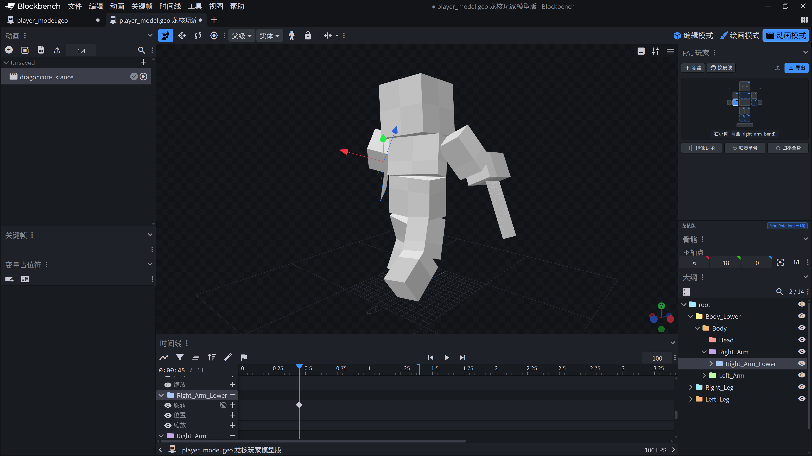
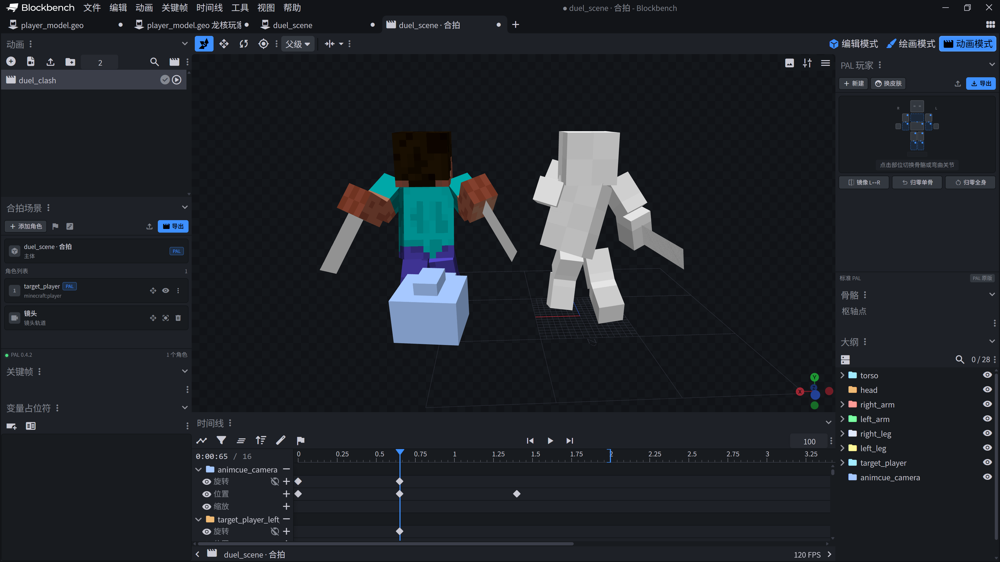

<p align="center">
  
</p>

<h1 align="center">PAL Bend Player Tools</h1>

<p align="center">
  <strong>Minecraft PlayerAnimationLib (PAL) bend-rig authoring, import/export, and Blender/Python interop for Blockbench</strong>
</p>

<p align="center">
  <strong>English</strong> · <a href="README_zh.md">简体中文</a> · <a href="https://github.com/kltyton/Pal-bend-player-tools/wiki">Wiki</a> · <a href="https://github.com/kltyton/AnimCue-Studio">AnimCue Studio</a> · <a href="https://github.com/kltyton/ParticleCue-Studio">ParticleCue Studio</a>
</p>

---

**PAL Bend Player Tools** is a Blockbench plugin and companion toolset for creating, editing, importing, and exporting Minecraft [PlayerAnimationLib (PAL)](https://github.com/ZigytheBird/PlayerAnimationLib) player animations — supporting both **PAL standard single-axis bends** and **MoreRotation 3-axis bends**, **DragonCore player rigs**, **KosmX Blender 5.2+ JSON round-trips**, and live multi-actor integration with **[AnimCue Studio](https://github.com/kltyton/AnimCue-Studio)**.



## Key Features

- **One-Click Player Rigs (Standard PAL & DragonCore)** — Create ready-to-animate Bedrock player projects using the bundled `player_model.geo` bend rig or the DragonCore (`root > Body_Lower > Body > *_Lower`) hierarchy, complete with skin loading and helper bend bones.
- **Interactive PAL Player Sidebar Panel** — Click any limb or bend joint on the visual body diagram to select bones immediately, mirror poses `L ↔ R`, reset a single bone or full pose, and check active rig / bend-mode badges at a glance.
- **PAL Vanilla & MoreRotation (3-Axis) Support** — Author and round-trip standard PAL `bend` / `bendDirection` tracks as well as full 3-axis `MoreRotation` bend vectors without losing metadata, loop return ticks, or per-axis Bezier handles.
- **Blender 5.2+ & Emote JSON Round-Trip** — Import and export PAL animation JSON, Emotecraft `.emote.json`, and KosmX Blender 5.2+ exporter JSON (including animation-local `model`/`parents`, `loopTick`, and custom bones).
- **Seamless AnimCue Studio Co-Install** — Exposes a clean runtime interop bridge (`PAL 0.4.2`) so [AnimCue Studio](https://github.com/kltyton/AnimCue-Studio) can spawn PAL standard or DragonCore players as multi-actor scene participants and export per-actor PAL emote files.

### DragonCore Player Rig & MoreRotation (3-Axis)



### Co-Installed with AnimCue Studio (Multi-Actor Scenes)



## Installation

### Option 1: Blockbench Plugin Store (Recommended)

1. Open **Blockbench** (desktop or web).
2. Go to **File → Plugins → Available** and search for **PAL Bend Player Tools**.
3. Click **Install**.

### Option 2: Manual Install from This Repository

1. Download [`pal_bend_player_tools.js`](pal_bend_player_tools.js).
2. In Blockbench, open **File → Plugins → Load Plugin from File** and select `pal_bend_player_tools.js`.

## Quick Start

1. In the **PAL Player** sidebar panel (or **File / Tools** menu), click **New** to create either a **Standard PAL** or **DragonCore** player project.
2. Switch to **Animate** mode, load a custom player skin if desired, and click limbs or elbow/knee dots in the panel body map to pose the rig.
3. Use **Mirror L↔R**, **Reset Bone**, and **Reset Pose** while blocking keyframes.
4. Click **Export** to save PAL animation JSON or Emote JSON directly, or use **Import** to bring existing PAL / Emotecraft / Blender 5.2+ animations onto the rig.

## Repository Structure

```text
Pal-bend-player-tools/
├── pal_bend_player_tools.js        # Blockbench plugin entry (ready to load)
├── icon.png                        # Plugin store icon
├── models/                         # Bundled reference player rigs & UV skin texture
│   ├── player_model.geo.bbmodel
│   ├── player_model.geo.json
│   ├── player_model.geo.png
│   └── player_model_dragoncore.geo.json
├── scripts/                        # Standalone Python CLI converters (PAL ↔ Bedrock / Emote)
│   ├── pal_source_lib.py
│   ├── animations_to_emote.py
│   ├── emote_to_animations.py
│   └── traditional_bend_to_pal_bend.py
├── blender/                        # Unmodified KosmX/emotes Blender 5.2+ upstream snapshot (GPL-3.0)
│   ├── UPSTREAM.md
│   ├── emote_creator.blend
│   ├── export.py
│   ├── export_functions/
│   └── legacy/                     # Legacy Blender rig & exporter for older workflows
│       ├── emote_creator_bend_item_scale.blend
│       └── emote_blender_exporter_legacy.py
├── tests/                          # Automated Node.js contract tests
│   └── blender_contract.test.cjs
└── docs/
    └── images/                     # Blockbench showcase screenshots
```

## Python CLI Converters

All standalone converters live in `scripts/` and require Python 3.8+ (standard library only):

```bash
# Convert a PAL / Emotecraft JSON into Blockbench player_model.geo animation JSON
python scripts/emote_to_animations.py input.emote.json -o output.animation.json

# Convert Blockbench player_model.geo helper-bend animation JSON back into PAL emote JSON
python scripts/animations_to_emote.py input.animation.json -o output.emote.json

# Convert traditional helper-bend tracks into PAL bend format
python scripts/traditional_bend_to_pal_bend.py input.animation.json -o output_pal.animation.json
```

## Development & Tests

Run the automated contract suite (Node.js 20+):

```bash
node --test tests/blender_contract.test.cjs
```

## Documentation (Wiki)

- [Home](https://github.com/kltyton/Pal-bend-player-tools/wiki)
- [Getting Started](https://github.com/kltyton/Pal-bend-player-tools/wiki/Getting-Started)
- [Player Rigs & Bend Conventions](https://github.com/kltyton/Pal-bend-player-tools/wiki/Player-Rigs-and-Bend-Conventions)
- [Import, Export & MoreRotation](https://github.com/kltyton/Pal-bend-player-tools/wiki/Import-Export-and-MoreRotation)
- [AnimCue Studio Integration](https://github.com/kltyton/Pal-bend-player-tools/wiki/AnimCue-Studio-Integration)
- [Blender & Python Workflow](https://github.com/kltyton/Pal-bend-player-tools/wiki/Blender-and-Python-Workflow)
- [Troubleshooting](https://github.com/kltyton/Pal-bend-player-tools/wiki/Troubleshooting)

## License

- The Blockbench plugin, models, Python converters, and tests are licensed under the [MIT License](LICENSE).
- Files directly under [`blender/`](blender/UPSTREAM.md) (excluding `blender/legacy/`) are an unmodified snapshot of [KosmX/emotes](https://github.com/KosmX/emotes) and remain under their upstream [GPL-3.0 License](blender/LICENSE).
