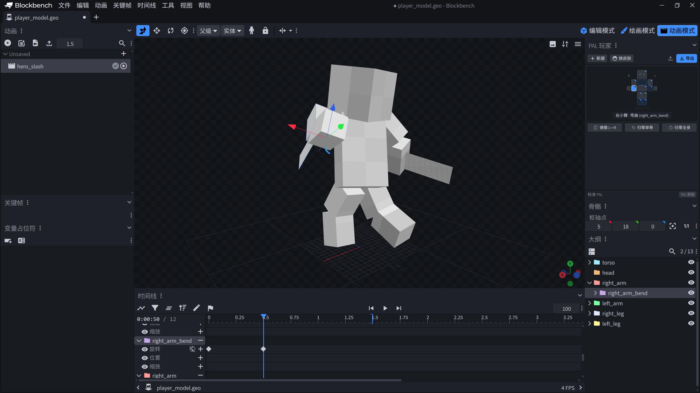
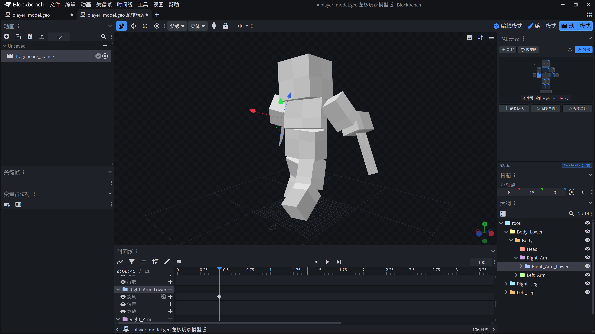
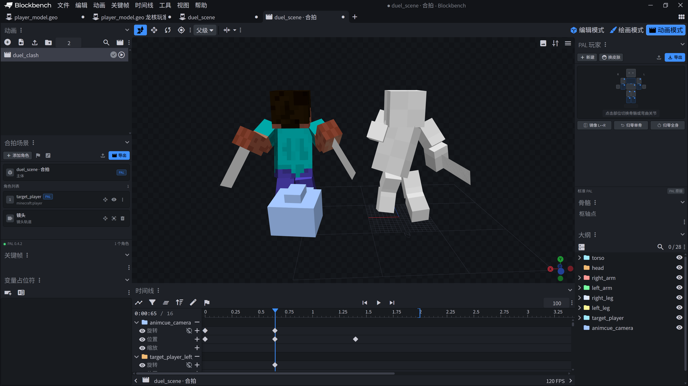

<p align="center">
  
</p>

<h1 align="center">PAL Bend Player Tools</h1>

<p align="center">
  <strong>面向 Blockbench 的 Minecraft PlayerAnimationLib (PAL) 弯曲玩家骨骼制作、导入导出与 Blender/Python 互通工具集</strong>
</p>

<p align="center">
  <a href="README.md">English</a> · <strong>简体中文</strong> · <a href="https://github.com/kltyton/Pal-bend-player-tools/wiki/Home-zh">中文 Wiki</a> · <a href="https://github.com/kltyton/AnimCue-Studio">AnimCue Studio</a> · <a href="https://github.com/kltyton/ParticleCue-Studio">ParticleCue Studio</a>
</p>

---

**PAL Bend Player Tools** 是一套专为 Minecraft [PlayerAnimationLib (PAL)](https://github.com/ZigytheBird/PlayerAnimationLib) 打造的 Blockbench 插件及配套脚本工具，完整支持 **PAL 原版单轴弯曲**、**MoreRotation 三轴弯曲**、**龙核玩家模型版骨骼**、**KosmX Blender 5.2+ JSON 双向往返**，以及与 **[AnimCue Studio](https://github.com/kltyton/AnimCue-Studio)** 的实时多角色合拍协作。



## 核心特性

- **一键创建标准 PAL / 龙核玩家工程** — 内置 `player_model.geo` 弯曲骨骼与龙核版（`root > Body_Lower > Body > *_Lower`）层级预设，开箱即用，支持直接更换任意玩家皮肤。
- **交互式「PAL 玩家」侧边面板** — 在人体示意图中点选部位或弯曲关节即可快速切换选中骨骼；内置 **镜像 L↔R**、**归零单骨**、**归零全身** 与当前骨架/弯曲模式状态徽标。
- **完整支持 PAL 原版与 MoreRotation（三轴弯曲）** — 精准往返 `bend` / `bendDirection` 单轴弯曲及三轴向量弯曲，保留循环回跳时刻（`loopTick`）、各轴贝塞尔手柄与自定义附加骨骼轨道。
- **Blender 5.2+ 与 Emote JSON 双向互通** — 原生导入导出 PAL 动画 JSON、Emotecraft `.emote.json` 及 KosmX Blender 5.2+ 导出产物（兼容动画局部 `model`/`parents` 与 PAL 元数据）。
- **与 AnimCue Studio 无缝共装** — 提供运行时桥接接口（`PAL 0.4.2`），让 [AnimCue Studio](https://github.com/kltyton/AnimCue-Studio) 可直接向合拍场景添加标准 PAL 或龙核玩家角色，并按角色拆分导出 PAL 动画。

### 龙核玩家模型版与 MoreRotation（三轴弯曲）



### 与 AnimCue Studio 共装（多角色合拍场景）



## 安装方式

### 方式一：通过 Blockbench 插件商店安装（推荐）

1. 打开 **Blockbench**（桌面端或网页端）。
2. 进入 **文件 → 插件 → 可用插件**，搜索 **PAL Bend Player Tools**。
3. 点击 **安装**。

### 方式二：手动加载本仓库插件

1. 下载仓库根目录的 [`pal_bend_player_tools.js`](pal_bend_player_tools.js)。
2. 在 Blockbench 中打开 **文件 → 插件 → 从文件加载插件**，选中 `pal_bend_player_tools.js`。

## 快速上手

1. 在右侧 **PAL 玩家** 面板点击 **+ 新建**，选择 **标准 PAL 玩家** 或 **龙核玩家模型版**。
2. 切换到 **动画模式**，按需点击 **换皮肤** 导入玩家贴图；在面板人体示意图中直接点选肢体或肘/膝关节即可调节旋转与弯曲。
3. K 帧时可随时使用 **镜像 L↔R**、**归零单骨**、**归零全身** 提升对称动作效率。
4. 点击 **导出** 输出 PAL 动画 JSON / Emote JSON，或点击 **导入** 将已有的 PAL / Emotecraft / Blender 5.2+ 动画回载到当前骨骼继续精修。

## 仓库目录结构

```text
Pal-bend-player-tools/
├── pal_bend_player_tools.js        # Blockbench 插件主入口（可直接加载）
├── icon.png                        # 插件商店图标
├── models/                         # 内置参考玩家模型与 UV 贴图
│   ├── player_model.geo.bbmodel
│   ├── player_model.geo.json
│   ├── player_model.geo.png
│   └── player_model_dragoncore.geo.json
├── scripts/                        # 独立 Python 命令行转换脚本（PAL ↔ Bedrock / Emote）
│   ├── pal_source_lib.py
│   ├── animations_to_emote.py
│   ├── emote_to_animations.py
│   └── traditional_bend_to_pal_bend.py
├── blender/                        # 未修改的 KosmX/emotes Blender 5.2+ 上游快照（GPL-3.0）
│   ├── UPSTREAM.md
│   ├── emote_creator.blend
│   ├── export.py
│   ├── export_functions/
│   └── legacy/                     # 面向旧版工作流的传统 Blender 工程与导出脚本
│       ├── emote_creator_bend_item_scale.blend
│       └── emote_blender_exporter_legacy.py
├── tests/                          # Node.js 自动化契约测试
│   └── blender_contract.test.cjs
└── docs/
    └── images/                     # Blockbench 实机演示截图
```

## Python 命令行转换脚本

所有独立转换脚本统一收纳在 `scripts/` 下，仅依赖 Python 3.8+ 标准库：

```bash
# 将 PAL / Emotecraft JSON 转为 Blockbench player_model.geo 动画 JSON
python scripts/emote_to_animations.py input.emote.json -o output.animation.json

# 将 Blockbench player_model.geo 弯曲动画 JSON 导出为 PAL emote JSON
python scripts/animations_to_emote.py input.animation.json -o output.emote.json

# 将传统 helper-bend 动画轨道转换为 PAL bend 格式
python scripts/traditional_bend_to_pal_bend.py input.animation.json -o output_pal.animation.json
```

## 开发与自动化测试

运行仓库内自动化契约测试（需 Node.js 20+）：

```bash
node --test tests/blender_contract.test.cjs
```

## 文档导航（Wiki）

- [中文首页](https://github.com/kltyton/Pal-bend-player-tools/wiki/Home-zh)
- [快速开始](https://github.com/kltyton/Pal-bend-player-tools/wiki/Getting-Started-zh)
- [玩家骨骼与弯曲约定](https://github.com/kltyton/Pal-bend-player-tools/wiki/Player-Rigs-and-Bend-Conventions-zh)
- [导入导出与 MoreRotation 三轴弯曲](https://github.com/kltyton/Pal-bend-player-tools/wiki/Import-Export-and-MoreRotation-zh)
- [与 AnimCue Studio 协作](https://github.com/kltyton/Pal-bend-player-tools/wiki/AnimCue-Studio-Integration-zh)
- [Blender 与 Python 命令行工作流](https://github.com/kltyton/Pal-bend-player-tools/wiki/Blender-and-Python-Workflow-zh)
- [常见问题排查](https://github.com/kltyton/Pal-bend-player-tools/wiki/Troubleshooting-zh)

## 开源许可

- 本仓库的 Blockbench 插件、模型资产、Python 脚本与测试代码采用 [MIT License](LICENSE)。
- [`blender/`](blender/UPSTREAM.md) 下的上游文件（不含 `blender/legacy/`）取自 [KosmX/emotes](https://github.com/KosmX/emotes) 未修改快照，沿用其上游 [GPL-3.0 许可](blender/LICENSE)。
